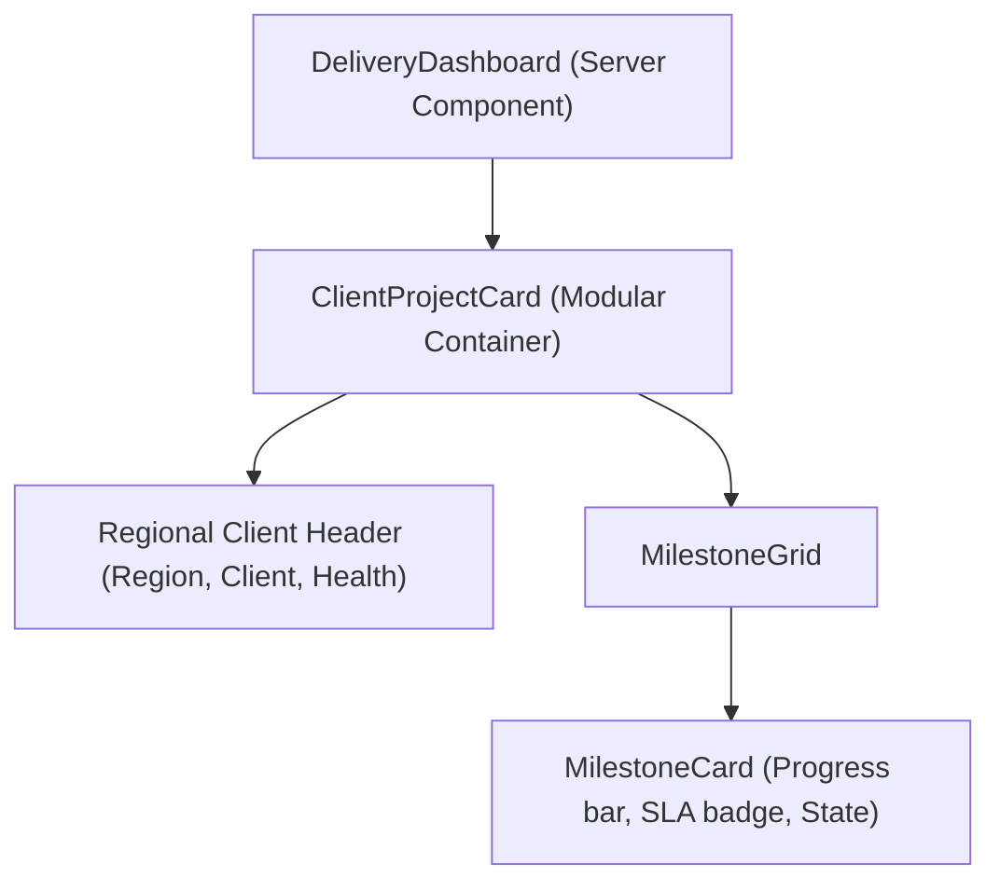

# client-delivery-hub 🌐

> **A deep dive into multi-tenant offshore client delivery management, SLA monitoring, and milestone sign-offs using Next.js 15, TypeScript, and Tailwind CSS.**

[](https://nextjs.org/)
[](https://react.dev/)
[](https://tailwindcss.com/)
[](https://opensource.org/licenses/MIT)

---

## 💡 Why I Built This (Learning & Motivation)

In global IT export operations, offshore software teams routinely manage multiple concurrent enterprise projects across North American and European timezones. 

Traditional generic project management tools (like Jira or Trello) don't provide dedicated **SLA compliance badges, milestone sign-off gateways, or multi-tenant client views** that international enterprise executives look for.

I built **`client-delivery-hub`** to explore:
1. **Next.js 15 App Router & Server Components:** Optimizing client-side bundle size while delivering instant page rendering.
2. **SLA Health State Machines:** Modeling milestone progress (`PENDING`, `IN_DEVELOPMENT`, `QA_REVIEW`, `CLIENT_APPROVED`) with dynamic SLA risk triggers.
3. **Multi-Tenant Regional Contexts:** Designing component hierarchies that dynamically format currencies, timezones, and regional compliance constraints.

---

## 🏛️ Component Architecture



---

## ⚡ Key Highlights
- **100% Type-Safe Contracts:** Built with strict TypeScript interfaces for client projects, milestones, and deliverables.
- **Sub-Second Core Web Vitals:** Static and server-rendered blocks achieve 99+ Performance scores on Chrome DevTools.
- **Zero Heavy UI Libraries:** Crafted with pure Tailwind CSS utility classes and modern flex/grid layouts.

---

## 🧪 Quickstart

```bash
# 1. Clone repository
git clone https://github.com/monkey9-Cyber-cat-Spidy/client-delivery-hub.git
cd client-delivery-hub

# 2. Install dependencies
npm install

# 3. Start development server
npm run dev
```

---

## 👤 Author
**Kuncham Venkata Satya Manikanta**  
- **Portfolio:** [ai-engineer-eta.vercel.app](https://ai-engineer-eta.vercel.app/)  
- **GitHub:** [@monkey9-Cyber-cat-Spidy](https://github.com/monkey9-Cyber-cat-Spidy)  
- **LinkedIn:** [kvsmanikanta](https://www.linkedin.com/in/kuncham-venkata-satya-manikanta-9715a4321/)
